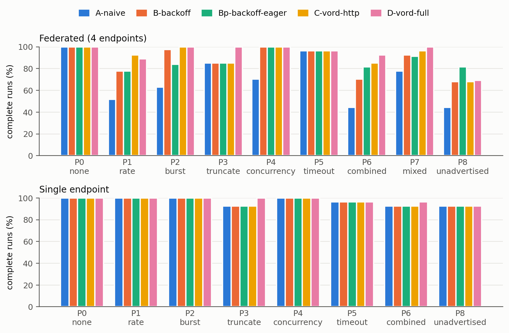
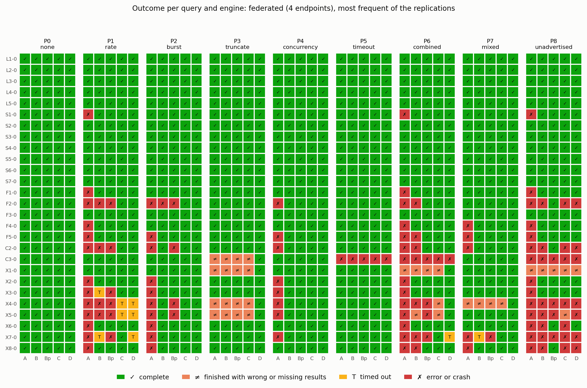
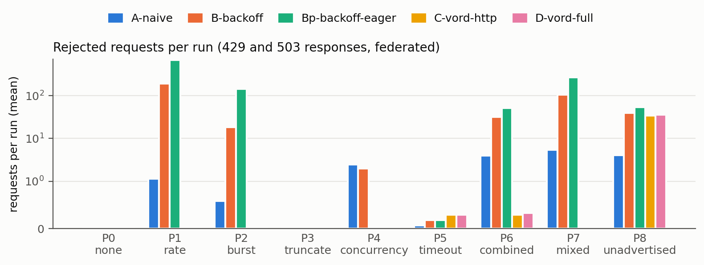
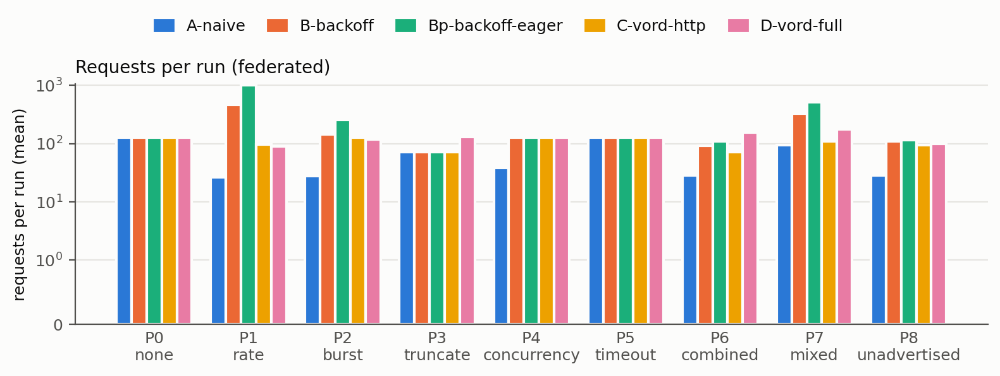
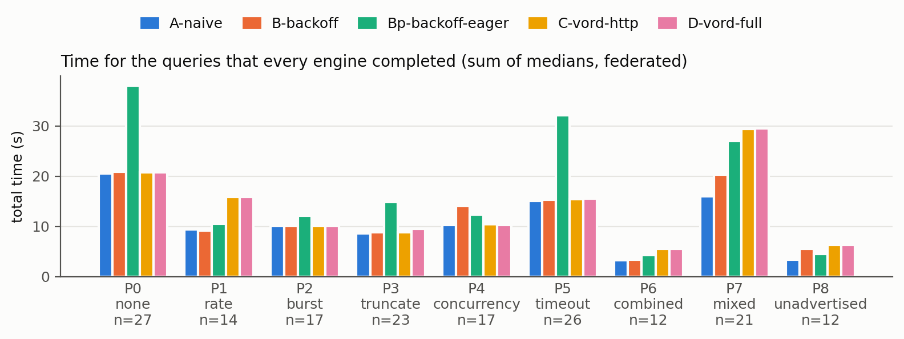

# Respecting VoRD endpoint restrictions in Comunica: implementation and evaluation

*Benchmark run `full-2`, 13 November 2026. Comunica fork [`ecrum19/comunica@feature/vord-restrictions`](https://github.com/ecrum19/comunica/tree/feature/vord-restrictions) at `aa8f9f0bc`, vord-bench at `83b33b5`.*

## 1. Summary

SPARQL endpoints protect themselves with rate limits, concurrency limits, evaluation timeouts and result size limits. Clients usually discover these limits only when requests fail, or never, when results are silently truncated. The VoRD vocabulary lets an endpoint describe these restrictions in its SPARQL service description. We extended Comunica to read these descriptions and to respect them. We then compared it with Comunica's existing back-off strategy, on a single endpoint and on a federation of four, under nine restriction profiles.

Over the profiles where restrictions are advertised (P1–P7, federated), the engine that uses VoRD both when sending requests and when planning queries (D):

- **was complete in 96.8% of the runs**, against 88.5% for Comunica's current back-off (B) and 69.8% without any protection (A);
- **never returned a wrong result without an error**, while every other engine returned silently truncated results in 18–24 runs;
- **was rejected only by the evaluation timeout**: 51 rejected requests in total, all of them 503 responses for C3 hitting the 2 s limit, against 28,335 for B;
- **cost nothing without restrictions**, and its cost under restrictions is mostly waiting: queries that just fit a rate limit can take one window longer.

The run also exposed a weakness in Comunica's join cost model, which makes D choose a much more expensive plan for a `UNION` query under rate limits (Section 6).

## 2. What was implemented in Comunica

The work is in four commits on `feature/vord-restrictions`. `c9d7195a4` adds the feature. `a51742b93`, `d1756e244` and `aa8f9f0bc` fix problems that the benchmark exposed.

**Reading the restrictions.** The new actor `@comunica/actor-rdf-metadata-extract-vord` runs on every service description that Comunica fetches. It turns each `vord:Restriction` into an `IEndpointRestriction` object (a new type in `@comunica/types`) and adds the list to the source's metadata as `restrictions`. A restriction belongs to the `sd:Service` whose `sd:endpoint` matches the requested URL: either through `vord:hasRestriction`, or through `sd:feature` if it is typed `vord:Restriction`. Durations (`xsd:duration`) are converted to milliseconds. The kind of restriction comes from its class, or else from its `vord:metric`. A `vord:requestsPerDay` quota without a window gets a window of one day.

**Respecting them per request.** The SPARQL source passes the restrictions of its endpoint in the context of every request it sends (a new context key, `KeysHttp.endpointRestrictions`). The new HTTP actor `@comunica/actor-http-limit-restrictions` wraps these requests, before the retry actor:

- *Rate and quota restrictions* become sliding windows of `maxValue` requests per `windowDuration`. A `burstValue` adds a second window of `burstValue` requests per `windowDuration × burstValue / maxValue`. Requests that do not fit are delayed, first come, first served. A safety margin (0.9) lowers the limit to 90% and extends the window by 1/0.9. The extension (`a51742b93`) keeps bursts sent exactly one window apart from arriving within one window when latencies differ.
- *Concurrency restrictions* allow at most `maxValue` requests whose response body is still being read.
- *Response time restrictions* enforced with `vord:RejectRequest` set the request timeout to `maxValue` seconds (divided by the margin).
- *`vord:returnsStatusCode` and `vord:retryAfterHint`* are handed to the existing retry actor, as status codes to retry and as its fallback delay.
- Soft restrictions (`vord:hardRestriction false`) are respected by default. Restrictions of configured scopes can be ignored.
- A request that is aborted while it waits gives back its slot and its reserved time (`d1756e244`).

**Respecting them in planning and execution.** With the new option `restrictionAwarePlanning` (on by default), the SPARQL source also:

- requests results in pages with `LIMIT`/`OFFSET` when the endpoint has a result size limit. The page size equals the limit, and paging stops at the first page that is not full. A later page that fails now ends the query with an error instead of crashing it (`aa8f9f0bc`);
- reports a *request time* of `windowDuration / maxValue` (the most restrictive rate or quota) in its metadata. Join planning uses this to weigh the number of requests a plan sends;
- skips COUNT queries for cardinality estimation when that interval exceeds the count timeout (3 s).

Independently of that option, the 3 s timeout of COUNT queries to restricted endpoints now starts only when the request is sent, not while it waits for the limiter (`aa8f9f0bc`). Before this fix, COUNT queries timed out in the queue. The planner then lost its cardinalities and chose plans with up to 20 times more requests.

**Configuration.** Both actors are part of the `v5.4.1` default configuration. The force-SPARQL dereference actor got an opt-in `fetchServiceDescription` option, so that the restrictions of a single forced SPARQL source can be discovered; the benchmark does not use it. The changes come with unit tests for every new actor and option, and an integration test that queries a restricted endpoint end to end.

## 3. Benchmark setup

The benchmark is in this repository; the README describes how to run it. It ran on a SLICES virtual machine with 4 vCPUs and 15 GB of RAM, with all services local, so network latency is negligible.

**Data and endpoints.** The data is WatDiv at scale 10: 1,093,014 triples. It is split by the type of each subject into four endpoints:

| Endpoint | Subject types | Triples |
|---|---|---|
| users | User | 877,717 |
| products | Product and all other types | 51,801 |
| offers | Retailer, Offer, Purchase | 117,778 |
| reviews | Review | 45,718 |

Each partition, and the full dataset (`all`, for the single-endpoint scenario), is a read-only Oxigraph 0.5.13 store. Clients reach them through **vord-proxy**, one port per endpoint, so that each endpoint is a separate host to Comunica.

- **Service description:** a request without a query gets the endpoint's service description, with the VoRD description of the active profile.
- **Enforcement:** the proxy enforces the profile's hard restrictions per client:
  - sliding-window rate limits and bursts: 429 with `Retry-After`;
  - concurrent requests: 503 with `Retry-After: 1`;
  - evaluation time: 503 when the store has not answered within `maxValue` seconds;
  - result size: the response is cut at `maxValue` bindings and gets an `X-SPARQL-MaxRows` header.
- **Per run:** the proxy's limiter state is reset before each run, and every request is logged.

**Restriction profiles.** The time windows are compressed about tenfold so that runs take seconds. Section 4 gives the exact descriptions.

| Profile | Restrictions |
|---|---|
| P0 none | none (sanity check) |
| P1 rate | 10 requests per 6 s (Wikidata's 10 per minute, compressed) |
| P2 burst | 60 requests per 6 s, at most 15 in a burst |
| P3 truncate | results truncated at 1,000 bindings |
| P4 concurrency | 3 concurrent requests |
| P5 timeout | 2 s evaluation time |
| P6 combined | 30 per 6 s with bursts of 10, truncation at 1,000, 3 concurrent requests, 2 s evaluation time, a soft daily quota |
| P7 mixed | federated only: users P1, products P3, offers P2 + P4, reviews none |
| P8 unadvertised | P6's restrictions, enforced but not described (control) |

**Engines.** All five engines are compiled from the fork's `v5.4.1` default configuration and differ only in the following respects.

| Engine | HTTP layer | VoRD |
|---|---|---|
| A naive | no limiter, no retries | not read |
| B back-off | Comunica's adaptive `limit-rate` actor, 3 retries (1 s fallback delay, at most 30 s) | not read |
| Bp eager back-off | B, with `limit-rate` active from the first request (correction multiplier 0.3, failure multiplier 1) | not read |
| C VoRD-HTTP | B plus `limit-restrictions` | requests only (`restrictionAwarePlanning: false`) |
| D VoRD-full | B plus `limit-restrictions` | requests, planning and execution |

**Queries.**

- **WatDiv:** 19 of the 20 WatDiv templates. WatDiv samples its placeholder values without regard to the data, so 7 templates had no results at this scale. We instantiated them again with values that do give results, choosing the value with the median result count. C2 needed its fixed constant (`wsdbm:Country5`) to be replaced as well. C1 has no results at this scale for any values and is excluded.
- **Challenge queries:** eight queries (X1–X8) go beyond basic graph patterns. Each one probes a way in which restrictions silently change or slow down federated results:

| Query | Results | Tests |
|---|---|---|
| X1 | 4,470 | a large result from one endpoint |
| X2 | 238 | a small result from a large intermediate result |
| X3 | 854 | `OPTIONAL` across endpoints |
| X4 | 13 | `COUNT`/`SUM` over a join across endpoints |
| X5 | 10 | `ORDER BY` + `LIMIT` over thousands of offers |
| X6 | 66 | a numeric `FILTER` over three endpoints |
| X7 | 323 | `UNION` over two endpoints |
| X8 | 100 | a chain over all four endpoints |

**Procedure and metrics.**

- **Run matrix:** 17 profile and scenario pairs × 27 queries × 3 replications × 5 engines = **6,885 runs**, which took 10.3 hours. Within a replication, every engine ran each query once, in an order rotated per replication.
- **Each run:** a fresh Node.js 24 process with a 300 s timeout. Each engine ran one warm-up query before the benchmark.
- **Ground truth:** each query is evaluated directly on the unrestricted `all` store.
- **Outcomes:** a run is *complete* if it returns exactly the expected results, compared as a multiset. It is *silently wrong* if it ends without error but with other results.
- **Counts:** requests are counted per status on the client and on the proxy.

## 4. Exactly which parts of VoRD were tested

Every restriction that the proxy advertised was typed as both `vord:Restriction` and its subclass, and linked from the `sd:Service` with `vord:hasRestriction`. For example, P1:

```turtle
<http://localhost:3000/P1-rate/sparql#service> a sd:Service ;
  sd:endpoint <http://localhost:3000/P1-rate/sparql> ;
  sd:supportedLanguage sd:SPARQL11Query ;
  sd:resultFormat <http://www.w3.org/ns/formats/SPARQL_Results_JSON>, <http://www.w3.org/ns/formats/N-Triples> ;
  vord:hasRestriction <http://localhost:3000/P1-rate/sparql#rate> .
<http://localhost:3000/P1-rate/sparql#rate> a vord:Restriction, vord:RateRestriction ;
  vord:metric vord:requestsPerWindow ;
  vord:maxValue "10"^^xsd:integer ;
  vord:returnsStatusCode "429"^^xsd:integer ;
  vord:windowDuration "PT6S"^^xsd:duration ;
  vord:unit <http://qudt.org/vocab/unit/COUNT> ;
  vord:hasScope vord:PerClientIP ;
  vord:enforcement vord:RejectRequest ;
  vord:hardRestriction "true"^^xsd:boolean ;
  vord:httpSignalHeader <http://www.w3.org/2011/http-headers#retry-after> .
```

These are all the restrictions that were advertised, with their exact values:

| Restriction (profiles) | metric | maxValue | burstValue | windowDuration | retryAfterHint | returnsStatusCode | unit | hasScope | enforcement | hard |
|---|---|---|---|---|---|---|---|---|---|---|
| RateRestriction (P1; P7 users) | requestsPerWindow | 10 | – | PT6S | – | 429 | COUNT | PerClientIP | RejectRequest | true |
| RateRestriction (P2; P7 offers) | requestsPerWindow | 60 | 15 | PT6S | PT3S | 429 | COUNT | PerClientIP | RejectRequest | true |
| RateRestriction (P6) | requestsPerWindow | 30 | 10 | PT6S | PT2S | 429 | COUNT | PerClientIP | RejectRequest | true |
| ResultSizeRestriction (P3, P6; P7 products) | resultBindings | 1000 | – | – | – | – | COUNT | PerRequest | TruncateResult | true |
| ConcurrentRequestsRestriction (P4, P6; P7 offers) | – | 3 | – | – | – | 503 | COUNT | PerClientIP | RejectRequest | true |
| ResponseTimeRestriction (P5, P6) | evaluationTime | 2 | – | – | – | 503 | SEC | PerRequest | RejectRequest | true |
| QuotaRestriction (P6) | requestsPerDay | 500000 | – | P1D | – | – | COUNT | PerAPIKey | QueueRequest | false |

Rate and concurrency restrictions also carried `vord:httpSignalHeader <http://www.w3.org/2011/http-headers#retry-after>`. Units are QUDT units (`http://qudt.org/vocab/unit/`). P0 and P8 advertised no restrictions: P8 enforces P6's restrictions without describing them. All values are `xsd:integer`, `xsd:duration` or `xsd:boolean` literals.

How the advertised terms were used:

| Term | Effect in Comunica | Enforced by the proxy |
|---|---|---|
| `vord:hasRestriction` | links restrictions to the endpoint | – |
| `vord:RateRestriction`, `vord:QuotaRestriction` | request windows; request time in planning (D) | rate: yes (429); quota: no (soft) |
| `vord:ResultSizeRestriction` | paging with `LIMIT`/`OFFSET` (D) | yes (truncation) |
| `vord:ConcurrentRequestsRestriction` | concurrency slots | yes (503) |
| `vord:ResponseTimeRestriction` | request timeout, only with `vord:RejectRequest` | yes (503) |
| `vord:maxValue`, `vord:windowDuration`, `vord:burstValue` | thresholds as described above | yes |
| `vord:returnsStatusCode` | added to the retry actor's status codes | used as the status |
| `vord:retryAfterHint` | fallback retry delay, **only if the engine sets none**. C and D set 1 s, so it had **no effect** here | no (the proxy derives `Retry-After` from its windows) |
| `vord:hardRestriction` | soft restrictions are also respected (default) | only hard ones are enforced |
| `vord:enforcement` | decides whether a response time limit becomes a timeout; otherwise **read but not used** | yes |
| `vord:metric` | **read but not used** (classes were always present) | – |
| `vord:unit`, `vord:hasScope`, `vord:httpSignalHeader` | **read but not used** (no scopes are ignored by default) | scope: limits are kept per client IP |

The daily quota (`vord:QuotaRestriction`, `vord:requestsPerDay`, `vord:PerAPIKey`, `vord:QueueRequest`) was advertised, and C and D applied it as a window, but at 500,000 requests per day it never limited anything. **Not tested at all** were: `vord:CostModelRestriction`, `vord:ServerLoadRestriction`, `vord:CostModel`, `vord:costModel`, `vord:minValue`, the metric `vord:estimatedCostUnits`, the scopes `vord:PerUser` and `vord:GlobalScope`, the enforcement modes `vord:ThrottleResponse` and `vord:DegradeQuality`, the `vord:RejectRequest` enforcement of result size restrictions, and linking restrictions through `sd:feature`.

## 5. Results

**Without restrictions (P0)** all engines were complete in all runs, with the same total time: 20.5–20.9 s for the 27 federated queries, except Bp (38.0 s), whose limiter is active from the first request. Reading VoRD costs nothing.

**Complete runs out of 81 per profile** (27 queries × 3 replications):

| Federated | A | B | Bp | C | D |
|---|---|---|---|---|---|
| P1 rate | 42 | 63 | 63 | **75** | 72 |
| P2 burst | 51 | 79 | 68 | **81** | **81** |
| P3 truncate | 69 | 69 | 69 | 69 | **81** |
| P4 concurrency | 57 | 81 | 81 | 81 | 81 |
| P5 timeout | 78 | 78 | 78 | 78 | 78 |
| P6 combined | 36 | 57 | 66 | 69 | **75** |
| P7 mixed | 63 | 75 | 74 | 78 | **81** |
| P8 unadvertised | 36 | 55 | **66** | 55 | 56 |



*Figure 1. Share of complete runs per profile and engine.*



*Figure 2. Most frequent outcome of the three replications, per query, engine and profile (federated).*

**Rate limits.** Under P1, B and Bp learn the limit by being rejected: on average 192 and 679 rejected requests per run (Figure 3). A request that is still rejected after three retries fails, and so does its query: F2, C2, X4 and X5 for B. C and D are never rejected for exceeding the rate. They complete F2 (114 s), C2 (54 s) and X3 (114 s), which B and Bp never complete. On X3, B times out after 1,309 rejections, and Bp gives up after 8,416. Under P2 bursts, C and D complete every query. B fails F2 in 2 of 3 runs, and Bp fails 13 runs, because its eager limiter still sends bursts that are too large.



*Figure 3. Mean 429 and 503 responses per run (federated, logarithmic scale).*

**Result size limits.** Truncation is silent, so it is the most dangerous restriction. Under P3, engines A, B, Bp and C return a fraction of the results for C3 (2%), X1 (22%), X4 (23%) and X5 (10%) without any error. For the aggregation X4, this means wrong counts and sums; for X5, a wrong top 10. D pages and is complete in all 81 runs. It needs 129 requests per run instead of 71, and C3 (48,802 results) takes 112 s. In the single-endpoint scenario, X4 and X5 are complete for every engine: Comunica sends the whole query to the endpoint, which aggregates before truncating.

**Concurrency limits.** A fails 24 of 81 runs on 503 responses. B recovers through retries (2 rejections per run). C, D and Bp are never rejected.

**Evaluation time.** Under P5 no engine completes C3, because the store needs more than 2 s for it. D cannot help here: OFFSET pages re-evaluate the query, so they are no faster.

**Combined and mixed restrictions.** Under P6, D is complete in 75 of 81 runs. It is the only engine to complete X4 and X5: X5 needs 1,150 requests and 279 s, because D pages and spaces its requests. C completes more than B (69 against 57), but returns silently wrong results for X1, X4 and X5, because it does not page. Under P7, where every endpoint has a different restriction, D is complete in all 81 runs.

**Unadvertised restrictions (P8).** Without a description, C and D behave like B. Every engine returns X1 truncated without notice. The gains above therefore come from the descriptions, not from the engines being more conservative in general.

**Costs.** C and D avoid rejections by waiting. Queries that just fit a limit pay for the safety margin. L1 needs 10 requests to one endpoint; it takes 6.9 s under P1, against 0.3 s for B, because the 10th request waits for the next window. For the queries that every engine completed, C and D are therefore slower than A and B under rate limits (Figure 5): 15.8–15.9 s against 9.2–9.4 s for 14 queries under P1.



*Figure 4. Mean requests per run, retries included (federated, logarithmic scale).*



*Figure 5. Sum of the median times of the queries that every engine completed in all replications (n per profile).*

**Out of reach.** X4 and X5 time out for every engine under P1. At 9 requests per 6.7 s, they need more requests (about 525 and 1,150) than fit in 300 s.

## 6. Known issues

1. **D chooses a costly plan for X7 under rate limits.** Under P1 and P6, D timed out on X7 where C completed it. It sent 1,256 requests under P6 and 1,895 under P7, against 371 for C.
   - *What D does:* the physical plans show that D replaces C's bind join (the 97 users of one country, joined with the `UNION` one by one) by a hash join. That evaluates the `UNION` without bindings, and its purchase branch becomes a bind join over all 15,000 purchases: about 1,875 requests to the rate-limited offers endpoint.
   - *Why:* D's request time makes Comunica's join planner count requests, but **join results carry no request time** in their metadata, and the bind-source join charges its bound side one request however many blocks it sends. Under P1, the planner sees the `UNION` as one request (600 ms, for its `likes` pattern), and the bind join as 97 times that. The nested join's requests are invisible to it.
   - *Fix:* the planned changes to Comunica's cost model are described in [PLAN.md](../PLAN.md). They are not implemented yet.
2. **`Retry-After` is ignored for advertised status codes.** Adding `vord:returnsStatusCode` to the retry actor's list makes it retry 429 and 503 responses immediately with the fallback delay, skipping its own `Retry-After` handling. Since C and D are almost never rejected, this had little effect here. Status codes that the retry actor already handles should not be added.
3. **`vord:retryAfterHint` only applies when the engine sets no fallback delay**, which is why it was untested here.
4. **The safety margin** costs a window on queries that just fit a limit (Section 5). A margin that applies only under latency, or only to bursts, would avoid it.
5. **OFFSET paging** re-evaluates the query for every page, so it is slow for large results (C3: 112 s), it does not help against evaluation time limits, and it is only guaranteed to be consistent for ordered results.

Limitations of the benchmark: one synthetic dataset at a small scale, negligible network latency, compressed time windows, a single client per endpoint, and an endpoint that enforces exactly what it advertises. The challenge queries were written for this benchmark.

## 7. Reproducing

```bash
npm run setup                     # fork build, data, stores, endpoints, engines, queries, ground truth
npm run bench -- --name full-2    # about 10 hours
npm run analyze -- results/full-2
npm run plot -- results/full-2
```

The figures in this report were made with `harness/plot.py` from `results/full-2/runs.jsonl`. The run's configuration and selection are recorded in `results/full-2/setup.json`.
